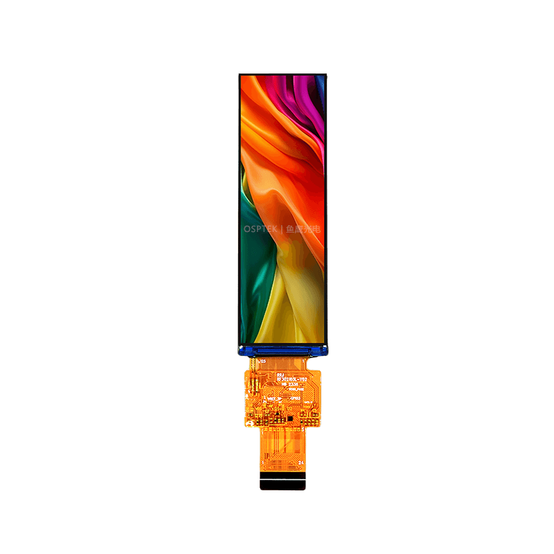
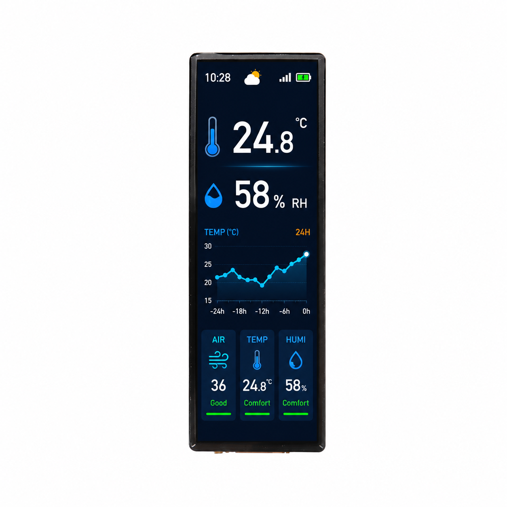

<h1 align="center">OSPTEK 3.02″ TFT 显示屏 170×560</h1>

<b>TFT 模组 · 多版本索引</b>

<a href="./README_EN.md">English</a> | 简体中文

  
  
  
  

## 目录

- [说明](#说明)
- [版本一览](#版本一览)
- [示例工程](#示例工程)
- [购买链接](#购买链接)
- [技术支持](#技术支持)

---

## 说明

本仓库收录 **3.02 寸 170×560 TFT** 显示模组资料。同一规格下可能有多个版本，驱动芯片、触摸方案、接口等细节以 `versions/` 下各版本自己的 README 为准。

**根目录 README 为导航页**。下表可快速浏览各版本；点击「完整资料」进入 `versions/` 下对应**料号文件夹**（产品页、规格书等资料均在该目录内）。示例工程不区分版本，统一放在仓库根目录的 [`examples/`](./examples/) 中，见下文「示例工程」一节。

规格标识（仓库名）：`display-tft-3.02inch-170x560`

---

## 版本一览

| 版本 | 宣传图 | 驱动 IC | 触摸驱动 | 接口 | 完整资料 |
| ---- | ------ | ------- | -------- | ---- | -------- |
| YDP302B001-V6 |  | AXS15231B | — | SPI | [完整资料](./versions/YDP302B001-V6/) |
| YDP302B003-V1 | — | AXS15231E | — | SPI/QSPI | [完整资料](./versions/YDP302B003-V1/) |
| YDP302BG001-V6 |  | AXS15231B | — | SPI | [完整资料](./versions/YDP302BG001-V6/) |
| YDP302BT001-V6 | — | AXS15231B | — | SPI | [完整资料](./versions/YDP302BT001-V6/) |

---

## 示例工程

示例代码在 [`examples/`](./examples/) 文件夹中。

---

## 购买链接

  
  &nbsp;&nbsp;
  

**国内（淘宝）**

- 店铺：[鱼鹰光电工厂店](https://shop110742373.taobao.com/)

**海外（AliExpress）**

- 店铺：[OSPTEK Official Store](https://www.aliexpress.com/store/1105701619)

---

## 技术支持

- 技术支持 / 产品咨询：<luyu@osptek.com>
- QQ 技术交流群：**985881096**
- 公司官网：<https://osptek.com/>
- 有任何问题，都可以在本仓库 Issues 中提问

---

© 2026 OSPTEK 鱼鹰光电 · 本仓库资料采用 CC BY 4.0 许可

