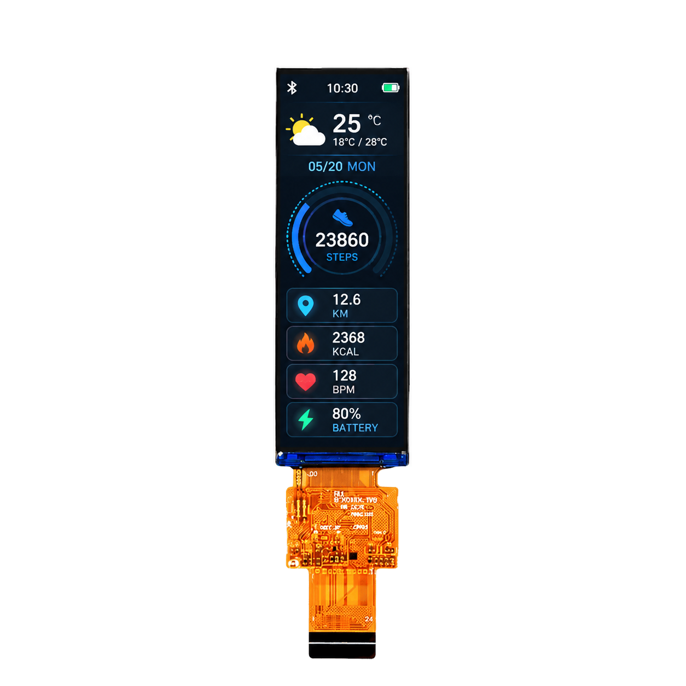
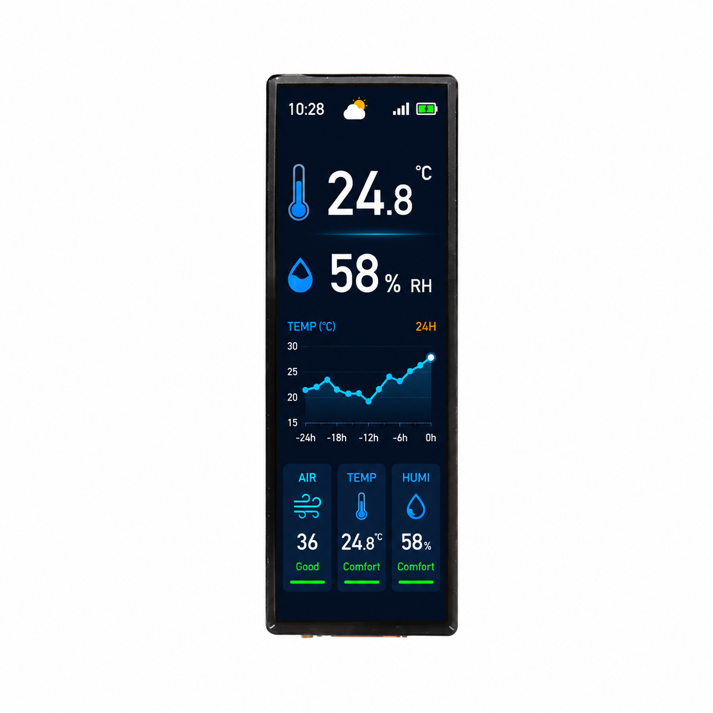
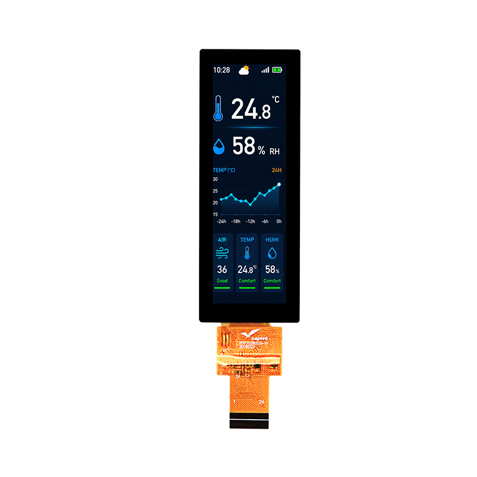

<p align="left"></p>

<div align="center">

# OSPTEK 3.02″ TFT Display 170×560

**TFT module · Multi-Version Index**

[简体中文](./README.md) &nbsp;/&nbsp; English


</div>

<br>

## Contents

| | |
| :--- | :--- |
| [About](#about) | What this repository holds and how to use it |
| [Versions](#versions) | Product photos and specs; open each part number's materials |
| [Repository Layout](#repository-layout) | Folder guide: where everything lives |
| [Sample Projects](#sample-projects) | Drivers and example code |
| [Firmware](#firmware) | Firmware files and online flashing |
| [Where to Buy](#where-to-buy) | Official Taobao and AliExpress stores |
| [Support](#support) | Contact |

<br>

## About

This repository holds materials for the **3.02″ 170×560 TFT** display module family. There may be multiple versions under the same spec; see each version's own README under `versions/` for driver chip, touch, and interface details.

> [!NOTE]
> **The root README is the navigation page.** Click a product photo below or **Full docs** to enter that **part-number folder** under `versions/` (product page, datasheets, etc. live there). Sample projects and firmware are not split per version — they live at the repo root.

Repo id: `display-tft-3.02inch-170x560`

<br>

## Versions

<table>
  <tr>
    <td align="center" width="50%">
      <a href="./versions/YDP302B001-V6/"></a>
      <br>
      <b>YDP302B001-V6</b>
      <br>
      <sub>AXS15231B · QSPI · Touch AXS15231B · <a href="./versions/YDP302B001-V6/">Full docs →</a></sub>
    </td>
    <td align="center" width="50%">
      <a href="./versions/YDP302B002-V6/"></a>
      <br>
      <b>YDP302B002-V6</b>
      <br>
      <sub>AXS15231E · QSPI · Touch AXS15231E · <a href="./versions/YDP302B002-V6/">Full docs →</a></sub>
    </td>
  </tr>
  <tr>
    <td align="center" width="50%">
      <a href="./versions/YDP302B003-V1/"></a>
      <br>
      <b>YDP302B003-V1</b>
      <br>
      <sub>AXS15231E · QSPI/SPI · Touch AXS15231E · <a href="./versions/YDP302B003-V1/">Full docs →</a></sub>
    </td>
    <td align="center" width="50%">
      <a href="./versions/YDP302BG001-V6/"></a>
      <br>
      <b>YDP302BG001-V6</b>
      <br>
      <sub>AXS15231B · QSPI · Touch AXS15231B · <a href="./versions/YDP302BG001-V6/">Full docs →</a></sub>
    </td>
  </tr>
  <tr>
    <td align="center" width="50%">
      <a href="./versions/YDP302BT003-V1A/"></a>
      <br>
      <b>YDP302BT003-V1A</b>
      <br>
      <sub>AXS15231E · QSPI/SPI · Touch AXS15231E · <a href="./versions/YDP302BT003-V1A/">Full docs →</a></sub>
    </td>
    <td></td>
  </tr>
</table>

<sub>

| Version | Driver IC | Touch IC | Interface | |
| :--- | :--- | :--- | :--- | :--- |
| YDP302B001-V6 | AXS15231B | AXS15231B | QSPI | [Full docs](./versions/YDP302B001-V6/) |
| YDP302B002-V6 | AXS15231E | AXS15231E | QSPI | [Full docs](./versions/YDP302B002-V6/) |
| YDP302B003-V1 | AXS15231E | AXS15231E | QSPI/SPI | [Full docs](./versions/YDP302B003-V1/) |
| YDP302BG001-V6 | AXS15231B | AXS15231B | QSPI | [Full docs](./versions/YDP302BG001-V6/) |
| YDP302BT003-V1A | AXS15231E | AXS15231E | QSPI/SPI | [Full docs](./versions/YDP302BT003-V1A/) |

</sub>

<br>

## Repository Layout

```text
display-tft-3.02inch-170x560/
├── README.md / README_EN.md     this page: spec navigation
├── LICENSE                      license (CC BY 4.0)
├── images/                      shared repository images
├── versions/                    full materials per version (part number)
│   └── <part-number>/
│       ├── README.md            specs and resource list
│       ├── osptek.yml           structured parameters
│       ├── datasheets/          product datasheet, driver / touch IC datasheets
│       ├── cad/                 outline / cover CAD
│       ├── code/                init reference code
│       ├── images/              product photos
│       ├── adapter/             adapter board materials and photos
│       └── misc/                other materials
├── examples/                    sample projects (shared by all versions)
└── firmware/                    firmware files
```

<br>

## Sample Projects

[`examples/`](./examples/) contains ready-to-build drivers and example code for common MCU/SoC platforms and toolchains, to help you light up the screen and verify the display quickly.

- **Scope**: examples are shared across all versions of this spec. Driver IC and interface differ between versions, so **check your model in "Versions" above** before choosing an example or init parameters.
- **How to use**: each example folder has its own README with the platform, wiring, and build/run steps.
- **More reference**: the `code/` folder under each version provides init reference code to compare against.
- **Contributions welcome**: if you have ported or built something new on this display, feel free to submit it to `examples/` via Pull Request.

<br>

## Firmware

The [`firmware/`](./firmware/) folder holds **prebuilt firmware** ready to use with this display. No development environment and no compiling: download it, flash it to your board, and see the screen light up right away. It is handy for quickly checking that a display works, comparing how different models look, or trying things out with no development experience.

<p align="center">
  <a href="https://www.yy.fyi/"></a>
</p>

**Method 1: Flash online**

Use our online flashing site — no software to install, everything runs in the browser:

1. Connect the board to your computer with a USB cable;
2. Click the "Flash Firmware Online" button above and choose the firmware;
3. Click connect and wait for flashing to finish.

**Method 2: Download and flash locally**

1. Open the [`firmware/`](./firmware/) folder and download the file that matches your model;
2. Flash it to the board with your preferred flashing tool, following the note that comes with the firmware.

> [!TIP]
> For online flashing, use a browser that supports Web Serial (such as Chrome or Edge), and make sure the cable carries data, not just power.

**Notes**

- Firmware matches the hardware: driver IC and interface differ between versions, so confirm your model in "Versions" above before picking a firmware.
- Firmware files are named by platform and function, with a note next to each one.
- To change features or port to your own project, get the source from "Sample Projects" above.
- If you run into problems while flashing or using it, open an [Issue](../../issues) or contact technical support.

<br>

## Where to Buy

<table>
  <tr>
    <td width="50%" valign="top">
      <sub>International</sub>
      <br>
      <b>AliExpress · OSPTEK Official Store</b>
      <br>
      <br>
      <a href="https://www.aliexpress.com/store/1105701619"></a>
    </td>
    <td width="50%" valign="top">
      <sub>China</sub>
      <br>
      <b>Taobao · 鱼鹰光电工厂店</b>
      <br>
      <br>
      <a href="https://shop110742373.taobao.com/"></a>
    </td>
  </tr>
</table>

<br>

## Support

<table>
  <tr>
    <td width="33%" valign="top">
      <sub>Technical Support / Sales</sub>
      <br>
      <b><a href="mailto:luyu@osptek.com">luyu@osptek.com</a></b>
    </td>
    <td width="33%" valign="top">
      <sub>QQ Technical Group</sub>
      <br>
      <b>985881096</b>
    </td>
    <td width="33%" valign="top">
      <sub>Feedback</sub>
      <br>
      <b><a href="../../issues">Open an Issue</a></b>
    </td>
  </tr>
  <tr>
    <td valign="top">
      <sub>Website</sub>
      <br>
      <b><a href="https://osptek.com/">osptek.com</a></b>
    </td>
    <td valign="top">
      <sub>Online firmware flashing</sub>
      <br>
      <b><a href="https://www.yy.fyi/">Open site</a></b>
    </td>
    <td valign="top">
      <sub>AliExpress / Taobao</sub>
      <br>
      <b><a href="#where-to-buy">Where to Buy</a></b>
    </td>
  </tr>
</table>

<br>

---

<p align="center"><sub>© 2026 OSPTEK · Licensed under CC BY 4.0</sub></p>
