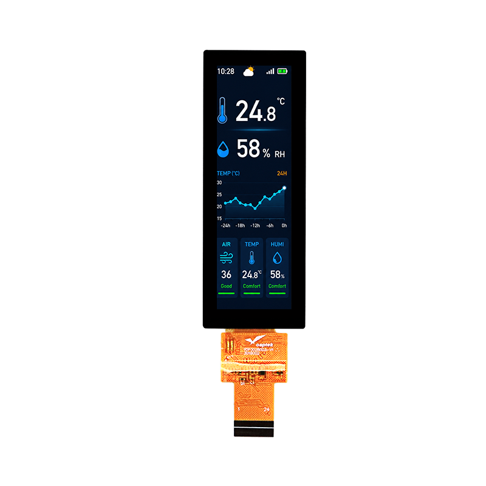

<p align="left"></p>

<h1 align="center">OSPTEK 3.02″ TFT Display 170×560 (YDP302BT003-V1A)</h1>

<p align="center"><b>TFT module · QSPI/SPI · AXS15231E</b></p>

<p align="center"><a href="./README.md">简体中文</a> | English · <a href="../../README_EN.md">Family index</a></p>

<p align="center">
  
  
  
</p>

<p align="center"></p>

## Contents

- [Specifications](#specifications)
- [Resources](#resources)
- [Repository layout](#repository-layout)
- [Buy](#buy)
- [Support](#support)

---

## Specifications

| Item | Spec |
| ---- | ---- |
| Size | 3.02 inch |
| Type | TFT |
| Resolution | 170×560 |
| Outline | 31.50 x 85.60 x 2.72 mm |
| Active area | 22.134 x 72.912 mm |
| Interface | QSPI/SPI |
| Driver IC | AXS15231E |
| Touch IC | AXS15231E |

> Full outline, FPC definition, power, and timing follow the product datasheet / driver IC datasheet.

## Resources

| Category | File |
| ---- | ---- |
| Datasheet | [`AXS15231E_Datasheet_V0.3_20251209-客户版 .pdf`](./datasheets/AXS15231E_Datasheet_V0.3_20251209-%E5%AE%A2%E6%88%B7%E7%89%88%20.pdf) |
| Datasheet | [`YDP302BT003-V1A.pdf`](./datasheets/YDP302BT003-V1A.pdf) |
| CAD file | [`YDP302BT003-V1A.dwg`](./cad/YDP302BT003-V1A.dwg) |

## Repository layout

```text
display-tft-3.02inch-170x560/ # repo root (nav: ../../README_EN.md; sample projects under root examples/)
└── versions/
    └── YDP302BT003-V1A/        # full materials for this part number
        ├── README.md
        ├── README_EN.md
        ├── osptek.yml
        ├── images/
        ├── datasheets/       # product datasheet + driver/touch IC datasheets
        └── cad/              # outline/cover CAD
```

## Buy

See the [repo home page](../../README_EN.md#where-to-buy).

## Support

See the [repo home page](../../README_EN.md#support).

---

<p align="center"><sub>© 2026 OSPTEK · Materials in this repository are licensed under CC BY 4.0</sub></p>
